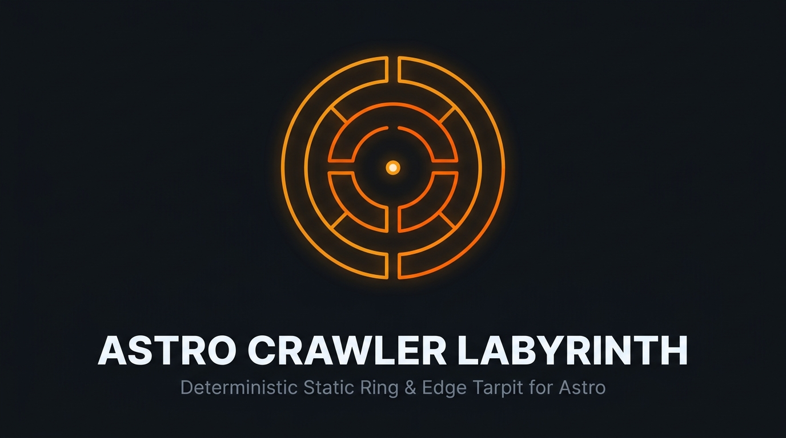
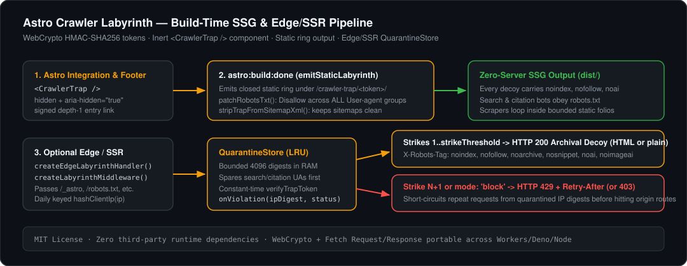
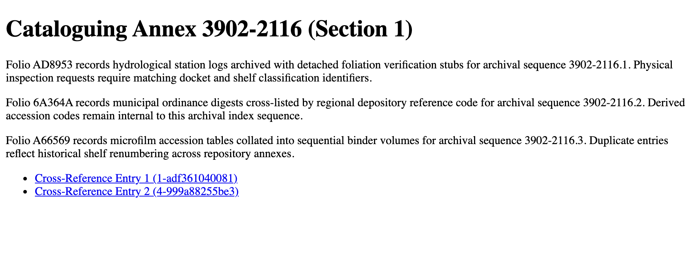

<p align="center">
  
</p>

<h1 align="center">Astro Crawler Labyrinth</h1>

<p align="center">
  <strong>Local deterministic crawler honeypot integration, accessible-inert <code>&lt;CrawlerTrap /&gt;</code> component, and Web-standard Edge/SSR quarantine handler for Astro.</strong>
</p>

<p align="center">
  <a href="https://github.com/arnoldwender/astro-crawler-labyrinth/actions/workflows/ci.yml"></a>
  <a href="LICENSE"></a>
  = 20.0.0" />
  =5" />
  
</p>

| Field | Value |
| --- | --- |
| **Author** | [Arnold Wender](https://arnoldwender.com) |
| **Repository** | [github.com/arnoldwender/astro-crawler-labyrinth](https://github.com/arnoldwender/astro-crawler-labyrinth) |
| **Companion WordPress Plugin** | [arnoldwender/crawler-labyrinth](https://github.com/arnoldwender/crawler-labyrinth) |
| **Companion Framework-Agnostic Core** | [crawler-labyrinth](https://github.com/arnoldwender/crawler-labyrinth-js) (`npm i crawler-labyrinth`) |
| **Runtime & Peer Support** | Node.js `>= 20.0.0` · Astro `^5 \|\| ^6 \|\| ^7` · WebCrypto & Fetch Standard |
| **License** | [MIT License](LICENSE) |
| **Built with an agentic workflow** | Developed with AI coding agents. Review and test it like any third-party code before you use it in production. |
| **Support & Liability** | **Zero support** — reproducible bugs on [GitHub Issues](https://github.com/arnoldwender/astro-crawler-labyrinth/issues) only · **no private support** · **AS IS / no liability** ([SUPPORT.md](SUPPORT.md)) |
| **Verification** | `npm run typecheck && npm run build && npm test && npm run test:mutations && npm pack --dry-run` |

---

## Why This Exists

`robots.txt` is a request, not a lock: RFC 9309 says its rules "are not a form of access authorization". A crawler that does not honor it can traverse every `<a href>` it extracts from HTML. Blocking by static User-Agent lists alone misses spoofed scrapers, while third-party bot-mitigation SaaS proxies add latency and send visitor metadata off-site.

`astro-crawler-labyrinth` keeps the entire defense deterministic, local, and reversible inside your Astro build and Edge/SSR runtime:

1. **Disallowed Entry Bait (`<CrawlerTrap />`):** Renders a native `hidden` + `inert` + `aria-hidden="true"` anchor pointing at `/${routePrefix}/<signed-token>/` with `tabindex="-1"` and `rel="nofollow noopener"`, keeping keyboard users, screen readers, and normal search indexing untouched.
2. **RFC 9309 Multi-Group `robots.txt` Patching:** Injects `Disallow: /${routePrefix}/` into **every** `User-agent:` group (not only `*`) so bots with dedicated `User-agent:` + `Allow: /` blocks (such as `OAI-SearchBot` or `PerplexityBot`) stay bound by the disallow rule.
3. **Static Ring & Dynamic Decoy Generation:** Emits a bounded ring of deterministic archival HTML decoy pages during `astro:build:done` (always marked `noindex, nofollow, noarchive, nosnippet, noai, noimageai`) and can additionally serve Web-standard Edge/SSR decoys or strike-based HTTP `429`/`403` quarantines with `Retry-After`.
4. **Zero-Network & Privacy-Safe:** No external SaaS APIs, no AI calls, and no raw client IP storage—strike tracking uses daily rotating keyed SHA-256 HMAC digests (`hashClientIp`).

---

## Quick Start

### 1. Install

```bash
npm install astro-crawler-labyrinth
```

Requires **Node.js `>= 20.0.0`** and **Astro `5.x`, `6.x`, or `7.x`**.

### 2. Add the Integration (`astro.config.mjs`)

Set a strong secret via environment variable (`>= 16` characters) for HMAC token signing and daily IP digests:

```js
import { defineConfig } from 'astro/config';
import crawlerLabyrinth from 'astro-crawler-labyrinth';

export default defineConfig({
  integrations: [
    crawlerLabyrinth({
      routePrefix: 'crawler-trap',
      mode: 'hybrid',
      staticPages: 24,
      maxDepth: 8,
      linkCount: 1,
      strikeThreshold: 5,
      blockTtlMs: 6 * 60 * 60 * 1000,
      blockStatus: 429,
      patchRobots: true,
      stripFromSitemap: true,
      secret: process.env.CRAWLER_LABYRINTH_SECRET,
    }),
  ],
});
```

> **Note:** Build `<CrawlerTrap />` with `npm run build` compiled in the package first (published packages include `dist/`). Avoid leaving the built-in fallback `DEFAULT_SECRET` active on public production deployments; provide a unique 16+ character `secret`.

### 3. Place `<CrawlerTrap />` in a Layout Footer

```astro
---
import CrawlerTrap from 'astro-crawler-labyrinth/components/CrawlerTrap.astro';
---

<footer>
  <!-- your visible footer markup -->
  <CrawlerTrap />
</footer>
```

At build time (`astro:build:done`), `astro-crawler-labyrinth`:

- emits deterministic depth-1..`maxDepth` decoy HTML pages under `dist/${routePrefix}/<token>/index.html` matching `<CrawlerTrap />` (skipped when `enableSsrEndpoint: true` so CDN static assets never shadow dynamic SSR quarantine/strike tracking),
- patches `dist/robots.txt` with `Disallow: /${routePrefix}/` across every `User-agent:` group (creating a minimal `robots.txt` if none exists),
- strips any matching `/${routePrefix}/...` entries recursively from `dist/sitemap*.xml` files (when using `@astrojs/sitemap`, list `crawlerLabyrinth()` **after** `sitemap()` in `integrations` so `astro:build:done` runs after the sitemap is generated).

---

## Architecture & Usage Modes

<p align="center">
  
</p>

### Static SSG Mode (Default)

Ideal for pure static sites (Netlify, Cloudflare Pages, Apache/Nginx, static buckets):

- `enableSsrEndpoint: false` (default) adds zero server dependencies.
- Non-compliant crawlers entering `/crawler-trap/<token>/` cycle through the bounded `staticPages` ring of interlinked `noindex, nofollow, noai` documents instead of hammering expensive content routes or origin functions.

### Astro SSR Endpoint & Middleware (`enableSsrEndpoint: true`)

For server-rendered or hybrid Astro apps, enabling `enableSsrEndpoint: true` injects:

- route `/${routePrefix}/[...slug]` (`astro-crawler-labyrinth/endpoint`), and
- pre-order middleware (`astro-crawler-labyrinth/middleware`) backed by `createEdgeLabyrinthHandler`.

In `hybrid` mode (default), requests to `/${routePrefix}/` (or optional training-only User-Agents when `interceptTrainingBots: true`) receive deterministic decoy documents for strikes `1..strikeThreshold`, then trigger HTTP `429` (with `Retry-After`) or `403` for the remainder of `blockTtlMs`.

### Standalone Web-Standard Edge Handler (`astro-crawler-labyrinth/edge`)

Use `createEdgeLabyrinthHandler` directly in Netlify Edge Functions, Cloudflare Workers, Deno, or custom Fetch servers:

```ts
import { createEdgeLabyrinthHandler } from 'astro-crawler-labyrinth/edge';

const labyrinth = createEdgeLabyrinthHandler({
  routePrefix: 'crawler-trap',
  mode: 'hybrid',
  strikeThreshold: 5,
  blockStatus: 429,
  secret: process.env.CRAWLER_LABYRINTH_SECRET,
  onViolation: (event) => {
    // `event.ipDigest` is a 64-char daily keyed HMAC-SHA256 hex digest (never raw IP).
    console.info(event.actionTaken, event.routeToken, event.status);
  },
});

export default async (request: Request, context: { next: () => Promise<Response>; ip?: string }) => {
  const blockedOrDecoy = await labyrinth(request, context.ip);
  if (blockedOrDecoy) {
    return blockedOrDecoy;
  }
  return context.next();
};
```

> **In-memory quarantine note:** `QuarantineStore` uses an in-memory bounded LRU map (`maxEntries = 4096` by default). Across multiple isolated serverless isolates or cold starts, each isolate tracks strikes independently; wire `onViolation` to an external KV store or edge firewall rule if you need global synchronization.

---

## Configuration Reference (`LabyrinthOptions`)

| Option | Type | Default | Constraints & Behavior |
| :--- | :--- | :--- | :--- |
| `routePrefix` | `string` | `'crawler-trap'` | 3–32 chars (`[a-z0-9_-]`); reserved paths (`_astro`, `_assets`, `api`, `media`, `well-known`, `robots`, `sitemap`, `favicon`, `admin`) fall back to `'crawler-trap'`. |
| `mode` | `'hybrid' \| 'labyrinth' \| 'block' \| 'observe'` | `'hybrid'` | `hybrid`: serve decoys up to `strikeThreshold`, then block. `labyrinth`: always serve decoys. `block`: quarantine on strike 1. `observe`: dry-run decoy + telemetry logging (`X-Crawler-Labyrinth: observed`) without quarantining. |
| `format` | `'html' \| 'plain'` | `'html'` | Response body format for Edge/SSR decoys (SSG always emits HTML documents). |
| `secret` | `string` | `DEFAULT_SECRET` | Minimum 16 characters required; shorter values fall back to default seed. |
| `staticPages` | `number` | `24` | Clamped to `4..256` decoy pages generated on `astro:build:done`. |
| `maxDepth` | `number` | `8` | Clamped to `1..16`; tokens wrap back to depth `1`. |
| `linkCount` | `number` | `1` | Clamped to `1..5`; number of default bait links emitted by `<CrawlerTrap />`. |
| `strikeThreshold` | `number` | `5` | Clamped to `1..100`; decoys served before quarantine in `hybrid` mode. |
| `blockTtlMs` | `number` | `21600000` (6h) | Clamped to `60_000..604_800_000` (1m to 7d). Sets `Retry-After` on HTTP `429`. |
| `blockStatus` | `429 \| 403` | `429` | HTTP status code sent during quarantine (`X-Crawler-Labyrinth: quarantined`). |
| `burstLimitPerMinute` | `number` | `300` | Global trap hits per 60 s UTC bucket before shedding flood requests with `429` (`X-Crawler-Labyrinth: burst-shed`, `Retry-After: 60`); `0` disables, otherwise clamped `5..10_000`. |
| `patchRobots` | `boolean` | `true` | Injects `Disallow: /<routePrefix>/` across all `User-agent` groups in `dist/robots.txt`. |
| `contentSignal` | `boolean` | `false` | Appends `Content-Signal: search=yes, ai-train=no` to `User-agent: *` when patching `robots.txt`. |
| `interceptTrainingBots` | `boolean` | `false` | Opt-in UA check for Edge/SSR mode (`GPTBot`, `CCBot`, `ClaudeBot`, `Bytespider`, `Scrapy`, etc.), strictly sparing search/citation bots first. |
| `enableSsrEndpoint` | `boolean` | `false` | Injects `/${routePrefix}/[...slug]` endpoint + `pre` middleware during `astro:config:setup`. |
| `stripFromSitemap` | `boolean` | `true` | Recursively removes matching `/<routePrefix>/` `<url>` blocks from `dist/sitemap*.xml` (list `crawlerLabyrinth()` after `@astrojs/sitemap()`). |
| `basePath` | `string` | `''` (auto from Astro `base`) | Subpath mount prefix (e.g. `'/docs'`) propagated automatically from `astro.config` `base`. |
| `trailingSlash` | `'always' \| 'never' \| 'ignore'` | `'always'` (auto from Astro `trailingSlash`) | Controls trailing slashes on emitted `<CrawlerTrap />` and decoy links; synced from `astro.config`. (`robots.txt` always emits `Disallow: <basePath>/<prefix>/`.) |
| `trustProxyHeaders` | `boolean` | `false` | Opt-in to read proxy IP headers when no explicit platform IP is passed. Without `trustedProxyHeader`, checks `cf-connecting-ip`, `x-nf-client-connection-ip`, `x-real-ip`, `x-forwarded-for` in order — leave `false` or pin `trustedProxyHeader` in multi-CDN setups where the edge only strips one vendor's header. |
| `trustedProxyHeader` | `string \| undefined` | `undefined` | When `trustProxyHeaders: true`, restricts header extraction strictly to a single validated lowercase header name (e.g. `'x-nf-client-connection-ip'` on Netlify or `'cf-connecting-ip'` on Cloudflare) so sibling CDN headers cannot be spoofed to bypass bans. |
| `entrySeed` | `string` | `'archroot0001'` | Sanitized alphanumeric seed (`4..24` chars) for deterministic bait tokens. |
| `onViolation` | `(event: TrapViolationEvent) => void \| Promise<void>` | `undefined` | Optional telemetry hook invoked with masked `ipDigest` and violation metadata. Because compiled SSR config injection (`INJECTED_CONFIG`) serializes JSON-only options, wire `createLabyrinthMiddleware({ onViolation })` in `src/middleware.ts` (or `createEdgeLabyrinthHandler({ onViolation })`) for production SSR builds rather than passing `onViolation` to `crawlerLabyrinth({ enableSsrEndpoint: true })`. |

---

## Search & Citation Crawler Safety

When `interceptTrainingBots` is enabled—or when checking `isTrainingOnlyUserAgent()` directly—search, citation, and preview crawlers are evaluated **before** training-scraper tokens (`ALLOWED_SEARCH_UA_TOKENS` takes strict precedence):

- **Spared search/citation/preview crawlers:** `Googlebot`, `Bingbot`, `Applebot`, `OAI-SearchBot`, `ChatGPT-User`, `Claude-SearchBot`, `Claude-User`, `PerplexityBot`, `Perplexity-User`, `MistralAI-User`, `Slackbot`, `Storebot-Google`, `DuckDuckBot`.
- **Trapped opt-in training/scraper tokens:** `GPTBot`, `CCBot`, `ClaudeBot`, `anthropic-ai`, `Bytespider`, `PetalBot`, `Diffbot`, `Omgilibot`, `ImagesiftBot`, `DataForSeoBot`, `Scrapy`.

Any crawler—regardless of User-Agent—that intentionally ignores `Disallow: /<routePrefix>/` in `robots.txt` and follows the inert trap link enters the labyrinth.

---

## Generated Decoy Output

Each emitted route (such as `Cataloguing Annex 3902-2116 (Section 1)` below) renders deterministic semantic archival HTML with `Folio` records, `noindex, nofollow, noarchive, nosnippet, noai, noimageai` directives, zero `<script>` tags, and bounded `Cross-Reference Entry` links back into the trap ring:

<p align="center">
  
</p>

---

## Development & Documentation

```bash
npm install
npm run typecheck
npm run build
npm test
npm run test:mutations
```

- [Architecture Guide](docs/ARCHITECTURE.md) — module boundaries, HMAC token grammar, RFC 9309 state machine, and Edge/SSG data flow.
- [Developer Guide](docs/DEVELOPER-GUIDE.md) — exported API surface, testing strategy, build verification, and release workflow.
- [Contributing](CONTRIBUTING.md) — pull request requirements and coding standards.
- [Support Policy](SUPPORT.md) — zero-support terms, GitHub-only bug reporting, and no-liability disclaimer.
- [Security Policy](SECURITY.md) — cryptographic design choices and private vulnerability reporting on GitHub.
- [Code of Conduct](CODE_OF_CONDUCT.md) — community participation standards.
- [Changelog](CHANGELOG.md) — release history.

---

## Companion Implementations

- **Framework-Agnostic Web Standards Core (Next.js, SvelteKit, Hono, Workers, Deno, Node):** [arnoldwender/crawler-labyrinth-js](https://github.com/arnoldwender/crawler-labyrinth-js) (`crawler-labyrinth` on npm, MIT)
- **WordPress Plugin (PHP 8.2+):** [arnoldwender/crawler-labyrinth](https://github.com/arnoldwender/crawler-labyrinth) (GPLv2+)

---

## Support, Bug Reports & Zero Liability

> **Zero Support & Use at Your Own Risk:** See [SUPPORT.md](SUPPORT.md).

- **Zero support:** This package is published as-is with **zero technical, setup, deployment, or user support**, and zero response SLA.
- **GitHub Issues only:** Reproducible software defects must be reported **exclusively** via [GitHub Issues](https://github.com/arnoldwender/astro-crawler-labyrinth/issues) (or [GitHub Security Advisories](https://github.com/arnoldwender/astro-crawler-labyrinth/security/advisories/new) for security vulnerabilities). Opening an issue creates no guarantee of a reply or fix.
- **No private support:** **Do not** send private support requests via email, `arnoldwender.com`, or direct messages. Private inquiries are never answered.
- **Zero responsibility & no warranty ("AS IS"):** Under the [MIT License](LICENSE), this software is provided **"AS IS"** without warranty of any kind, and the author accepts **zero responsibility or liability** for any damages, site outages, compute usage, false positives, or search/crawler indexing effects arising from its use.

---

## License

Licensed under the [MIT License](LICENSE).
