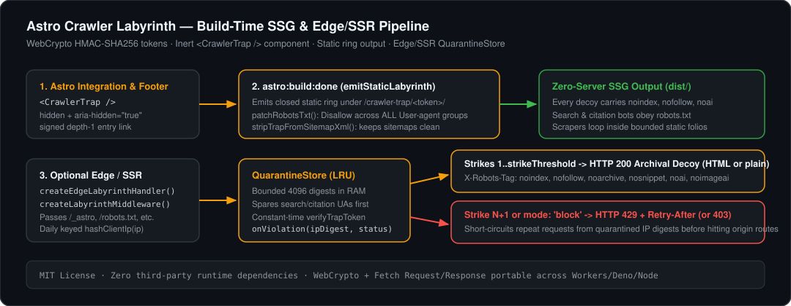

# Architecture

`astro-crawler-labyrinth` is a self-contained TypeScript package (no third-party runtime npm `dependencies`) plus an Astro component designed to trap abusive non-compliant crawlers across **Static SSG** (`astro:build:done`), **Astro SSR**, and **Web-standard Edge runtimes** (`Request` / `Response` + WebCrypto).

<p align="center">
  
</p>

---

## Module Boundaries

```text
astro.config.mjs ──▶ src/integration.ts (crawlerLabyrinth, emitStaticLabyrinth)
                          │
                          ├──▶ astro:config:setup
                          │       ├── stores resolved config via globalThis symbol + Vite runtime-config transform
                          │       ├── sets vite.ssr.noExternal: ['astro-crawler-labyrinth']
                          │       ├── propagates basePath & trailingSlash from Astro config
                          │       └── optionally injects endpoint (prerender: false) + pre-middleware
                          │
                          ├──▶ components/CrawlerTrap.astro ──▶ src/bait.ts (buildBaitLinks)
                          │
                          └──▶ astro:build:done
                                  ├── emitStaticLabyrinth() ──▶ src/generator.ts + src/crypto.ts
                                  ├── patchRobotsTxt()      ──▶ src/robots.ts (RFC 9309 multi-group)
                                  └── stripTrapFromSitemapXml() (recursive sitemap*.xml scan)
```

### Runtime & Edge Pipeline

```text
Incoming Request
   │
   ├─ Middleware skips static builds (`context.isPrerendered === true`)
   │
   ├─ Path normalization: safely URL-decode + collapse slashes + strip basePath
   │
   ├─ Route matches `/^\/<routePrefix>(?:\/([a-zA-Z0-9_-]{1,96}))?\/?$/i`
   │  OR (not excluded segment AND `interceptTrainingBots && isTrainingOnlyUserAgent(ua)`)
   │     │
   │     ├─ Missing client IP (and `trustProxyHeaders: false`): serve stateless decoy (`null` on HEAD), skip IP quarantine pooling
   │     ├─ Quarantined IP digest (`hashClientIp(normalizeClientIp(ip), secret)` in `QuarantineStore`)
   │     │     └─▶ HTTP 429 (`Retry-After`) or 403 + `X-Robots-Tag: noindex, nofollow, noarchive, nosnippet, noai, noimageai`
   │     └─ recordHit() in `QuarantineStore` (active bans protected from low-strike LRU eviction):
   │           ├─ strikes > strikeThreshold (or mode === 'block') ──▶ emit TrapViolationEvent + block response
   │           └─ otherwise ──▶ verifyTrapToken() (depth <= maxDepth) ─▶ generateDecoyDocument() ─▶ HTTP 200 HTML/plain + noai headers (`null` body on HEAD)
   │
   └─ Normal request ─▶ return null (next middleware / static file)
```

---

## Module Responsibilities

| Module | Responsibility |
| :--- | :--- |
| `src/types.ts` | Read-only TypeScript interfaces for integration options (`TrailingSlashMode`, `basePath`, `trustProxyHeaders`, `usesDefaultSecret`), decoy documents, bait links, and violation events. |
| `src/runtime-config.ts` | Holds serializable build-injected `INJECTED_CONFIG` populated in SSR server bundles via Vite `transform`. |
| `src/config.ts` | Option normalization, bounded integers, reserved-prefix rejection, `ALLOWED_SEARCH_UA_TOKENS` vs `TRAINING_ONLY_UA_TOKENS`, `basePath`/`trailingSlash` helpers, and config sharing across build/SSR. |
| `src/crypto.ts` | WebCrypto HMAC-SHA256 signing (`hmacSha256Hex`, `signTrapToken`, `verifyTrapToken`), constant-time hex comparison (`timingSafeEqualHex`), IP canonicalization (`normalizeClientIp`), and daily salted IP digests (`hashClientIp`). |
| `src/bait.ts` | Deterministic entry link builder (`buildBaitLinks`) synchronizing `<CrawlerTrap />` (including `basePath` and `trailingSlash`) with `emitStaticLabyrinth`. |
| `components/CrawlerTrap.astro` | Accessible-inert container (`hidden`, `inert`, `aria-hidden="true"`, `data-crawler-labyrinth="1"`) containing `tabindex="-1"`, `rel="nofollow noopener"` bait links. |
| `src/generator.ts` | Deterministic archival corpus generator (`generateDecoyDocument`) producing unique headings, folio codes, paragraphs, and child ring tokens without `<script>` tags. |
| `src/robots.ts` | RFC 9309 multi-group `robots.txt` injector (`patchRobotsTxt`, handling inline `#` comments, empty groups, and CRLF) and order-independent sitemap `<url>` sanitizer (`stripTrapFromSitemapXml`). |
| `src/quarantine.ts` | Bounded LRU strike tracker (`QuarantineStore`, default `4096` entries, floor `64`) evicting expired and non-quarantined entries before overflowing active bans. |
| `src/edge.ts` | Web-standard `createEdgeLabyrinthHandler` with opt-in `trustProxyHeaders` (`cf-connecting-ip`, `x-nf-client-connection-ip`, `x-real-ip`, `x-forwarded-for`), segment-bounded exclusions, and `HEAD` support. |
| `src/endpoint.ts` | Astro `APIRoute` factory (`createLabyrinthEndpoint`, `export const prerender = false`) + `GET` and `HEAD` handlers returning `404` (`noindex, nofollow`) for non-trap misses. |
| `src/middleware.ts` | Astro `MiddlewareHandler` factory (`createLabyrinthMiddleware`) skipping prerendered routes (`context.isPrerendered`) and delegating non-matching traffic to `next()`. |
| `src/integration.ts` | Astro integration lifecycle hooks (`astro:config:setup`, `astro:build:done`), Vite SSR config injection, default-secret/fallback warnings, static-ring emission (when `enableSsrEndpoint` is `false`), and recursive `sitemap*.xml` patching. |

---

## Cryptographic & Token Format

### Trap Token Grammar

Tokens follow `<depth>-<seed>-<sig16>`:

- `depth`: integer `1..16` matching `/^[1-9][0-9]?$/` (bounded statically via `maxDepth`).
- `seed`: sanitized lowercase alphanumeric identifier `4..24` chars.
- `sig16`: first 16 hex characters of `HMAC-SHA256("${depth}|${seed}", secret)`.

Verification (`verifyTrapToken`) checks syntax with a strict regex first, recomputes the HMAC via WebCrypto `crypto.subtle`, and compares the truncated 16-hex MAC using bitwise XOR accumulation (`timingSafeEqualHex`) to prevent early-exit timing leaks.

### Privacy-Safe IP Digesting

`hashClientIp(rawIp, secret, utcDay?)` computes:

```text
HMAC-SHA256("<trimmed-ip>|<YYYY-MM-DD>", secret)
```

- Raw IPs are never written into `QuarantineStore` keys or emitted in `TrapViolationEvent.ipDigest`.
- Daily UTC key rotation ensures strike correlation naturally unlinks across days without storing historical lookup tables.

---

## Static Ring Topology (`emitStaticLabyrinth`)

1. Entry links generated by `buildBaitLinks` form indices `0 .. linkCount - 1` of `ringTokens`.
2. Remaining static nodes `linkCount .. max(linkCount, staticPages) - 1` are deterministically derived using `hmacSha256Hex("ring|<entrySeed>|<idx>", secret)` at cycling depths `(idx % maxDepth) + 1`.
3. Each node `idx` links to two forward neighbors inside the ring—`(idx + 1) % total` and `(idx + 3) % total`—guaranteeing that every crawler path stays closed inside `/${routePrefix}/` with zero broken internal links during static builds.

---

## RFC 9309 `robots.txt` State Machine

Because RFC 9309 states that crawlers select their most specific matching `User-agent:` group (ignoring `*` whenever a dedicated agent block exists), appending `Disallow: /crawler-trap/` solely under `User-agent: *` would leave search/AI crawlers with explicit `Allow: /` sections unrestricted.

`patchRobotsTxt` scans line-by-line tracking group boundaries (`inGroup`, `hasNonUaDirective`, `groupHasDisallow`, `groupIsStar`, `groupHasSignal`), inserts `Disallow: /<prefix>/` immediately before trailing blank/comment lines of **every** group that lacks it, stays idempotent on repeated builds, and preserves optional `Sitemap:` lines cleanly.
